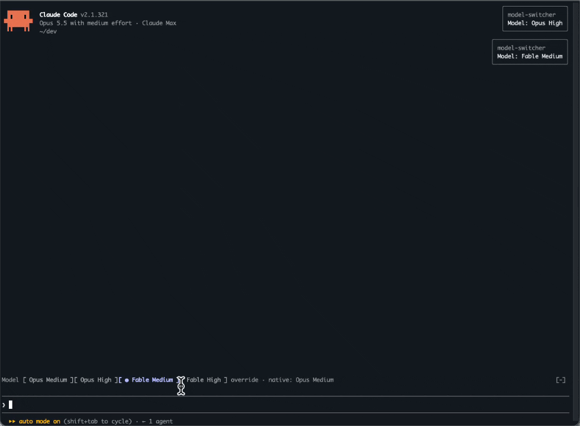

# cc-quick-switcher

A Claude Code mod that adds a model switcher above the prompt:

`[Opus Medium] [Opus High] [Fable Medium] [Fable High]`



- Click a button, or focus the band (`ctrl+x tab`) and press `1`–`4`.
- The active choice is highlighted. With no pick, it follows your `/model` and `/effort` setting.
- Press the active button again to go back to your native setting.
- Your pick is remembered across sessions. Subagents keep their own model.

## Install

In Claude Code:

```
/plugin install model-switcher --marketplace beydogan/cc-quick-switcher
```

Answer `y` to add the marketplace, then pick the user scope.
